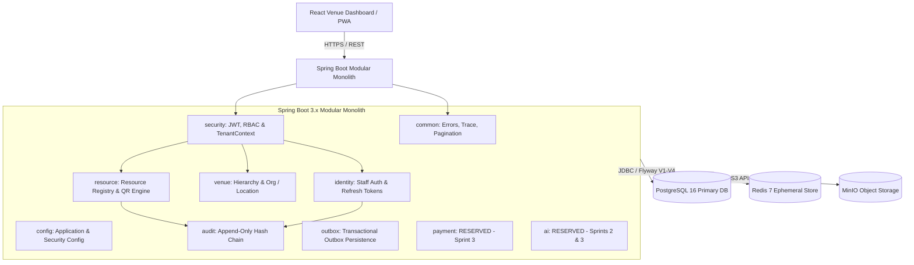

# VENUE NEXUS - System Architecture Specification

**Document Title:** System Architecture Specification  
**Version:** 0.1-DRAFT  
**Status:** DRAFT - awaiting approval by Rabeesh R  
**Owner:** Rithik Saran (Backend Lead)  
**Date:** 6 November 2026  

## Change Log
| Version | Date | Author | Description |
|---|---|---|---|
| 0.1-DRAFT | 6 November 2026 | Rithik Saran | Baseline draft of system architecture, modular monolith topology, layering rules, CR-01 to CR-05 boundaries, and observability. |

---

## 1. System Overview & Context

VENUE NEXUS is a multi-tenant physical-to-digital operations platform engineered for venues that manage physical spaces (restaurants, hotels, cafes, conference facilities, co-working desks). Physical resources (such as tables, rooms, counters, seats, and equipment) are registered in the system and bound to cryptographically unguessable QR identities.

The platform architecture follows a **domain-oriented Spring Boot modular monolith** for Release 1, strictly rejecting premature distributed microservice boundaries while enforcing clean internal module separation and strict layer governance.



---

## 2. Technology Stack & Pinned Versions

| Layer | Component | Version | Specification & Notes |
|---|---|---|---|
| **Language** | Java Development Kit (JDK) | 21 (LTS) | Modern Java runtime, virtual threads ready, record classes. |
| **Framework** | Spring Boot | 3.3.0 | Modern Spring Boot platform using Spring Framework 6.1. |
| **Build System** | Apache Maven | 3.9.6 | Dependency management and build packaging with `mvnw` wrapper. |
| **Frontend** | React + TypeScript + Vite | React 18.3, TS 5.4, Vite 5.2 | High-performance client-side application. |
| **Routing** | React Router | 6.23 | Client-side role-aware routing. |
| **Workspace** | pnpm Workspaces | 12.18 | Efficient monorepo package orchestration. |
| **Primary Database** | PostgreSQL | 16.3 | Permanent single source of truth; UUID primary keys; UTC timestamps. |
| **Schema Migrations** | Flyway | 10.12 | Strictly versioned, forward-only DDL scripts (V1–V4 in Sprint 1). |
| **Persistence / ORM** | Spring Data JPA / Hibernate | 6.5 (via Spring Boot) | Domain entity mapping; strict tenant-scoped repositories. |
| **Connection Pooling** | HikariCP | 5.1.0 | High-performance bounded connection pool; metrics observed via Micrometer. |
| **Ephemeral Cache** | Redis | 7.2 | Short-lived state (OTP counters, distributed locks, session status, cart). The client choice is Spring Boot's default Redis client, see `pom.xml` [CR-01]. |
| **Object Storage** | MinIO | RELEASE.2024-05-28 | S3-compatible local asset storage (QR codes, branding assets). |
| **API Documentation** | springdoc OpenAPI | 2.5.0 | OpenAPI 3.0 specification generation and Swagger UI. |
| **Validation** | Jakarta Bean Validation | 3.0.2 | Transport and service-level input constraint validation. |
| **Security** | Spring Security + JWT | 6.3.0 | Stateless JWT access tokens; opaque hashed refresh tokens. |
| **Observability** | Logback + MDC + Micrometer | 1.5.0 / Prometheus | Structured JSON logging with trace ID propagation and Prometheus endpoints. |
| **QR Engine** | ZXing | 3.5.3 | High-precision vector SVG and raster PNG QR rendering. |
| **Architecture Testing**| ArchUnit | 1.3.0 | Compile-time enforcement of module boundaries and layering rules. |

---

## 3. Modular Monolith Architecture & Module Boundaries

### 3.1 Strict Layering Rule
The monolith strictly enforces a unidirectional flow:
```text
Controller  -->  Service  -->  Repository
```
- **Controllers:** Responsible only for HTTP transport mapping, input format validation, and HTTP response translation. Controllers **must never access repositories directly**.
- **Services:** Responsible for business rules, authorization enforcement, transactional boundaries, and inter-module coordination.
- **Repositories:** Responsible strictly for database persistence operations.
- ArchUnit automated tests enforce these rules on every build.

### 3.2 Module Decoupling Rule
1. A module must expose a **public service interface** rather than allowing other modules to reach into its internal entities or repositories.
2. Cross-module calls occur strictly via Java service interfaces within the same application process.
3. Feature modules must never have circular dependencies.
4. The `common` module must remain completely independent of specific feature modules.

### 3.3 Active Sprint 1 Modules
- **`com.venuenexus.common`:** Unified API error responses (`ApiError`, `ErrorCode`), global exception mapping (`GlobalExceptionHandler`), distributed request tracing (`TraceIdFilter`), and pagination models (`PageParams`, `PageResponse`).
- **`com.venuenexus.config`:** Application configuration, CORS, and infrastructure settings.
- **`com.venuenexus.identity`:** Staff authentication, password hashing, failed-login lockout tracking, and refresh token rotation/reuse detection (Phase 3).
- **`com.venuenexus.security`:** Security filter chains, JWT validation, role-based access control (`@PreAuthorize`), `TenantContext`, and `ScopeContext` (Phase 3).
- **`com.venuenexus.venue`:** Platform tenants, organisations, locations, physical spaces (buildings, floors, zones), and departments (Phase 4).
- **`com.venuenexus.resource`:** Physical resource registry (tables, rooms, counters, seats) and cryptographically secure QR identity generation/revocation (Phase 5).
- **`com.venuenexus.audit`:** Append-only, tamper-evident SHA-256 hash-chained audit logging service.
- **`com.venuenexus.outbox`:** Outbox event persistence pattern ensuring reliable at-least-once domain event publication.

### 3.4 Reserved Module Boundaries (Design Only - No Code in Sprint 1)
- **`com.venuenexus.payment` [CR-02] (Planned for Sprint 3):**
  - **Boundary Rule:** Owns all payment transactions, receipts, refund lifecycles, and payment webhook integrations.
  - **Abstraction:** Interacts with external payment processors via a clean `PaymentProvider` interface.
  - **Independence Rule:** Payment status is strictly independent of operational order status. Other modules access payment functionality exclusively through its public service interface.
- **`com.venuenexus.ai` [CR-03] (Planned for Sprints 2 & 3):**
  - **Boundary Rule:** Advisory only. Must never participate in the critical business path or exit gates.
  - **Repository Isolation Rule:** The AI module **must not access another module's repository**. It receives minimised, tenant-scoped input data exclusively through public service interfaces.
  - **Safety Rule:** AI models never decide tenant scope, access control, prices, payments, or order lifecycle states.

---

## 4. Multi-Tenant Isolation Architecture

1. **Logical Separation:** Shared PostgreSQL database instance with logical tenant partitioning.
2. **Tenant Ownership:** Every tenant-owned table contains `tenant_id UUID NOT NULL` (with platform-level exceptions only where explicitly defined, e.g., `PLATFORM_ADMIN` users).
3. **No Client-Supplied Tenant ID:** Tenant identity is never accepted from request query parameters, request bodies, or path parameters for tenant-owned entities. Tenant identity is resolved strictly from the validated security context (`TenantContext`).
4. **Tenant-Scoped Repositories:** Repository methods for tenant-owned entities strictly enforce `tenantId` parameters. Plain unscoped `findById` is forbidden for tenant-owned tables.
5. **Cross-Tenant Concealment:** If an authenticated tenant attempts to access an entity belonging to a different tenant, the platform returns HTTP `404 Not Found` (`RESOURCE_NOT_FOUND`) to avoid revealing the existence of other tenants' records.

---

## 5. Ephemeral Infrastructure Architecture (Redis) [CR-01]

Redis is utilized strictly as an **ephemeral data store and high-speed cache**, never as the permanent source of truth (which is PostgreSQL 16).
- **Use Cases:**
  1. Rate-limiting and OTP verification attempt counters (Sprint 2).
  2. Short-lived customer session state and distributed locking (Sprint 2).
  3. Ephemeral shopping cart buffers (Sprint 2).
  4. Token revocation denylist (Phase 3).
- **Client Configuration [CR-01]:** Spring Boot's default Redis client is configured via standard Spring Boot starters (see `pom.xml`). The specific library name is an implementation detail and is not named here.
- **Scope Decision [D-1]:** CR-01 removes the library name from documentation while retaining Redis infrastructure. Any removal of Redis itself is tracked under Decision D-1 (*Pending Team Lead confirmation*).

---

## 6. Observability, Logging & Tracing

1. **Trace ID Propagation:** Every HTTP request is assigned a unique trace ID via `TraceIdFilter`. If a client sends an `X-Trace-Id` header matching `^[A-Za-z0-9-]{8,64}$`, it is reused; otherwise, a random UUIDv4 is generated.
2. **MDC Injection:** The trace ID is placed in the SLF4J Mapped Diagnostic Context (`MDC`) under the key `traceId` and printed on every log line via `logback-spring.xml`.
3. **Response Header:** Every HTTP response (both success and error) carries the `X-Trace-Id` header.
4. **Zero-Secret Logging Policy:** Passwords, JWTs, refresh tokens, raw QR tokens, Authorization headers, payment credentials, and AI keys **must never appear in application logs**.
5. **Actuator & Metrics:** Spring Boot Actuator exposes strictly `/actuator/health`, `/actuator/info`, and `/actuator/metrics` (with Prometheus scraping endpoint).

---

## 7. Environments & Deployment Topology

| Environment | Database | Redis | Object Storage | Configuration Source |
|---|---|---|---|---|
| **Local Dev** | PostgreSQL 16 (Docker) | Redis 7 (Docker) | MinIO (Docker) | `.env` via `application-local.yml` |
| **Test / CI** | In-Memory / Testcontainers | Testcontainers | Mocked / Local | `application-test.yml` |
| **Staging** | Managed PostgreSQL 16 | Managed Redis | Managed S3 | Environment variables / Cloud Secret Store |
| **Production** | Multi-AZ PostgreSQL 16 | Redis Cluster | Cloud Object Storage | Environment variables / Cloud Secret Store |
